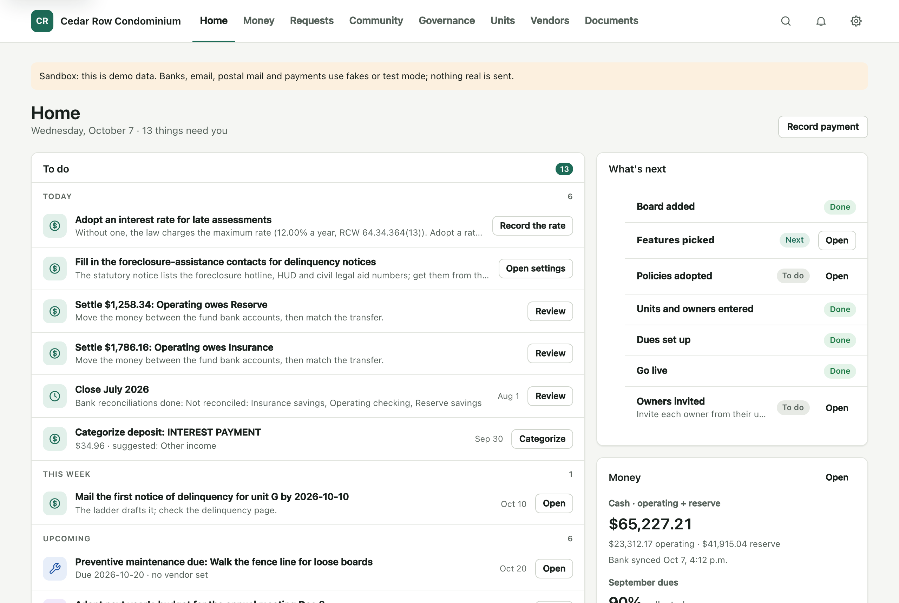
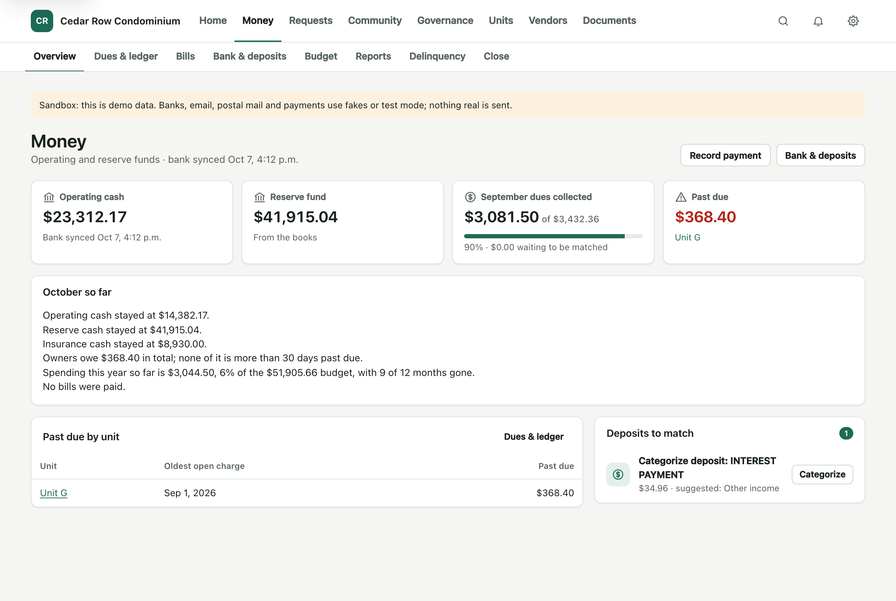
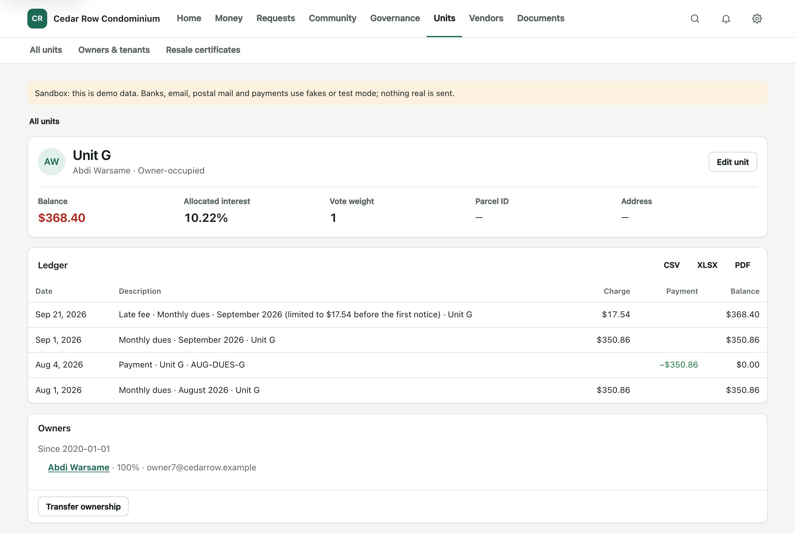
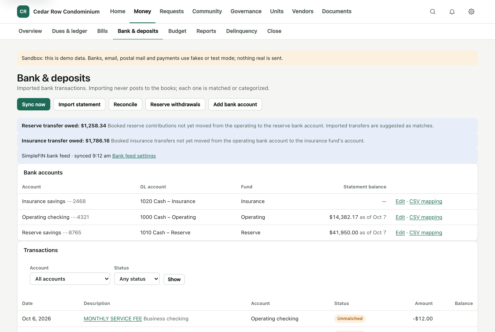
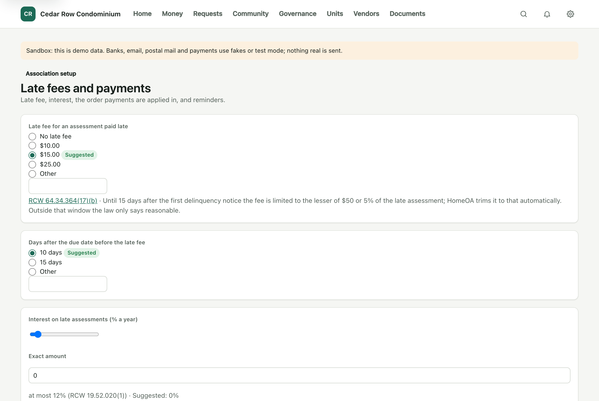
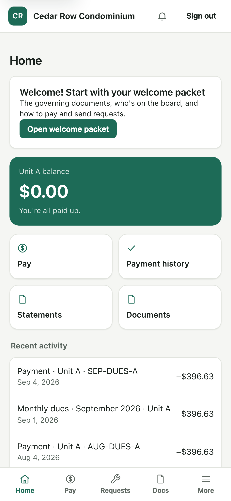

# HomeOA

[](https://github.com/rlukata/HomeOA/actions/workflows/ci.yml)
[](https://claude.com/claude-code)
[](LICENSE)

HomeOA is an open-source platform for running a homeowners or condominium association.
It is built for small, self-managed associations: the board does the work in one web app,
and owners and tenants get a portal.

It is a server-rendered Django application with a double-entry ledger at its centre, a
plugin system for outside services, and state law kept as data in rule packs.

> The repo's Washington rule pack has not been reviewed by an attorney. Nothing here is
> legal, tax or accounting advice.

## Screenshots

All screens show the fictional demo association created by `seed_demo`.

| | |
|---|---|
| **Board Home**: what needs doing, with setup progress and cash<br> | **Money overview**: cash by fund and the month in plain words<br> |
| **Unit ledger**: dues, a payment and a late fee capped by statute<br> | **Bank & deposits**: the bank feed, matched against the books<br> |
| **Association setup**: a policy question with the law behind it<br> | **Owner portal on a phone**<br> |

## What it does

- **Money:** a fund-based double-entry ledger (operating, reserve, insurance), dues
  schedules from each unit's allocated interest, special assessments, late fees, owner
  payments and autopay, bank feeds with matching and reconciliation, bills with approval
  rules, budgets, month and year-end close, financial reports, a monthly board packet,
  1099 totals and a Form 1120-H worksheet.
- **People and property:** units, owners, tenants, ownership history, a resident
  directory, roles and permissions, and board approval ("change requests") for sensitive
  changes.
- **Governance:** meetings with notices and minutes, resolutions, owner votes, a compliance
  calendar, click-to-sign, and a setup wizard that turns the board's policy answers into a
  draft resolution.
- **Community:** violations with hearings and fines, architectural requests, maintenance
  requests, work orders and preventive upkeep, announcements, a document library with
  full-text search, resale certificates and insurance summaries.
- **Notices:** email and printed letters with merge fields, per-owner consent to
  electronic notice, statements and delinquency notices, and a log of everything sent.
- **Moving in:** import units, owners, balances and ledger history from CSV exports, then
  compare HomeOA's books with the previous system to the cent before switching over.

HomeOA never initiates outbound payments. It records what the association's bank did.

## How it is built

- **Stack:** Python 3.14, Django, server-rendered templates with htmx, PostgreSQL,
  Procrastinate for background jobs.
- **Money is `Decimal`** everywhere, and every financial change posts through the ledger
  service as balanced double entry.
- **Association scope:** every model belongs to an association. The default manager
  filters to the current association and returns nothing when none is set.
- **Plugins** are in-process Python packages found through entry points. Every extension
  point has a default that works with no plugin: manual payments, file-upload bank import,
  SMTP, print-to-PDF letters, click-to-sign, local storage. The plugins in `plugins/` add
  Stripe (ACH), SimpleFIN (bank feeds), Lob (mailed letters), Tesseract (OCR), Claude
  (filling in a bill from an invoice) and the Washington rule pack.
- **State law is data.** Statute-driven values (notice periods, fee caps, quorum rules)
  live in dated rule packs, never in core code.
- **Text** goes through Django i18n.
- **Tests:** a unit and integration suite under `homeoa/`, `plugins/` and `tests/`, and a
  Playwright end-to-end suite under `e2e/` that drives the real app in a browser.

## Development

Requirements: [uv](https://docs.astral.sh/uv/), Docker, and gettext (`brew install gettext`)
for `makemessages`.

```sh
cp .env.example .env
docker compose up -d --wait db
uv sync
uv run manage.py migrate
uv run manage.py seed_demo         # optional: a sample 9-unit association
uv run manage.py runserver         # http://localhost:8000 ; emails print in this terminal
```

Sign-in is by magic link: enter an email at `/login/` and open the link printed in the
`runserver` terminal. After `seed_demo`, `treasurer@cedarrow.example` is a board member and
`ownera@cedarrow.example` is an owner. All demo names and addresses are fictional.

`/healthz` needs no login: 200 when the database answers, 503 when it does not.

Django admin (`/admin/`) is mounted only when `HOMEOA_ADMIN_ENABLED` is true: on by default
in development and tests, off in production. HomeOA's own settings pages are the intended
admin surface.

### Checks

`scripts/check.sh` runs `ruff check`, `ruff format --check`, a `makemessages -l en`
extraction check and `pytest` (extra arguments are passed to pytest).

### End-to-end tests

The default `pytest` run covers `homeoa/`, `tests/` and `plugins/` only. The end-to-end
suite runs separately, without pytest-django (see [`e2e/README.md`](e2e/README.md)):

```sh
uv run playwright install chromium
uv run pytest e2e -p no:django
```

### Settings modules

- `homeoa.settings.dev` (default for `manage.py`): DEBUG, email printed to the terminal.
- `homeoa.settings.test` (pytest): in-memory email, adds the test-only `tests.scoped` app.
- `homeoa.settings.e2e`: requires `HOMEOA_E2E=1`; DEBUG off, static files via WhiteNoise.
- `homeoa.settings.prod`: requires `HOMEOA_SECRET_KEY`.

### Several worktrees, one Postgres

`compose.yaml` uses a fixed project name, so every worktree shares one Postgres container.
Give each worktree its own database in its `.env`:

```sh
HOMEOA_DB_NAME=homeoa_feature_x
docker compose exec db createdb -U homeoa homeoa_feature_x
```

pytest-django creates `test_<HOMEOA_DB_NAME>` itself, so parallel test runs never collide.

### UI components

Forms, messages, tables, badges and empty states are shared components: see
[`homeoa/ui/README.md`](homeoa/ui/README.md). App templates carry no inline styles.

## Production

The production stack is one Docker Compose project: web, worker, PostgreSQL, Caddy for TLS
and nightly encrypted backups to any S3-compatible bucket. First deploy, upgrades, backups,
the restore drill and key rotation are in [`deploy/RUNBOOK.md`](deploy/RUNBOOK.md).

External services are used through provider interfaces. Use test keys and sandboxes in
development; never live keys.

## Contributing

Issues and pull requests are welcome: see [`CONTRIBUTING.md`](CONTRIBUTING.md). Report
security problems privately, as described in [`SECURITY.md`](SECURITY.md).

## License

[GNU Affero General Public License v3.0 or later](LICENSE).
